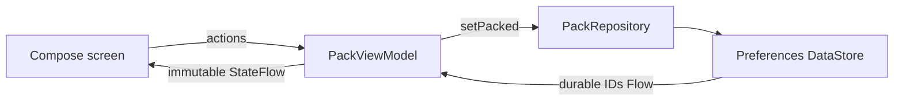

# Trail Pack

**A little preparation. More possibility.**

An original native Android showcase by [Ramy Saleeb](https://github.com/RamySaleeb): a small, offline packing checklist built with **Kotlin, Jetpack Compose, StateFlow, and Jetpack DataStore**.

The interface stays simple so the engineering decisions are easy to inspect: durable state, unidirectional data flow, lifecycle-aware collection, accessible controls, and explicit failure recovery. All content and application code were created for this public demo. No private or startup source is included.

**[Try Trail Pack in your browser →](https://ramysaleeb.github.io/android-native-architecture-lab/)** — no installation or sign-in.

The live demo is a lightweight HTML/JavaScript companion. The native Android implementation remains the focus of this repository.

## Try the browser companion

1. Pack **Water bottle**, then try **Remaining** and **Packed**.
2. Reload the page: your selections remain saved in this browser.
3. Select **Simulate next save failure**, then toggle an item. The saved selection stays unchanged and a recovery message appears.
4. Toggle the item again to save successfully. Use Tab and Space to explore with a keyboard.

The browser companion uses `localStorage`, with separate data from the Android app. It is not an Android emulator or Kotlin running in the browser. Unlike DataStore, localStorage does not provide atomic transactions across tabs. A blocked or malformed storage read keeps editing disabled until a successful retry; failed writes do not change the displayed saved state. The page requires an initial network load and is not an installable PWA.

The dependency-free web implementation lives in [`web/`](web/): `model.mjs` owns storage and filtering; `app.mjs` connects the model to accessible native controls; `style.css` adapts the layout to narrow screens. Eight Node tests cover persistence, filters, read/write failures, malformed data, and sequential cross-tab updates.

```sh
node --test web/model.test.mjs
python3 -m http.server 8770 --directory web
# Open http://localhost:8770
```

[Browser demo CI](https://github.com/RamySaleeb/android-native-architecture-lab/actions/workflows/pages.yml) runs the tests before deploying the public app assets to GitHub Pages. Keyboard interaction, reload persistence, failure recovery, and a 320px-wide layout were also checked in a browser.

## Native Android: a two-minute walkthrough

1. Launch the app. Six fictional items are grouped by Essentials, Clothing, and Extras.
2. Tap **Water bottle**. The progress count advances only when storage emits the saved state.
3. Choose **Remaining** or **Packed** to inspect the same data through a different filter.
4. Close and reopen the app. Packed items survive; the presentation filter starts at All after process recreation.
5. Scroll to **Under the hood** and select **Simulate next save failure**. Tap an item: a recovery message appears, and saved selections stay unchanged. Tap the item again to save successfully.

There is no server to configure, no sign-in, and no `INTERNET` permission. The failure switch is an explicit teaching tool; normal saves use real device storage.

## Run locally

Prefer a prebuilt APK? Open a successful [Android CI run](https://github.com/RamySaleeb/android-native-architecture-lab/actions/workflows/android.yml) and download the `trail-pack-debug` artifact (GitHub sign-in required). Extract it and install the APK on an Android device or emulator.

Requirements: Android Studio supporting AGP 9.1, JDK 17+, Android SDK 36, and an Android 8.0+ device or emulator (API 26+). Dependencies download from Google Maven, Maven Central, and the Gradle Plugin Portal.

```sh
git clone https://github.com/RamySaleeb/android-native-architecture-lab.git
cd android-native-architecture-lab
# Open this directory in Android Studio, let Gradle sync, then Run app.
# Or set ANDROID_HOME to your SDK directory and use:
sh gradlew :app:assembleDebug
sh gradlew :app:installDebug
```

The Kotlin application runs on Android; the separate [browser companion](https://ramysaleeb.github.io/android-native-architecture-lab/) makes its core interactions available without installation. The debug APK is produced at `app/build/outputs/apk/debug/app-debug.apk`; successful CI builds also retain an APK artifact for 14 days. Debug signing is for evaluation only.

## Architecture worth reading



| Boundary | Responsibility | Start here |
| --- | --- | --- |
| Compose | Render state; emit user actions; collect only with the lifecycle | [MainActivity.kt](app/src/main/java/com/ramysaleeb/trailpack/MainActivity.kt) |
| ViewModel | Read/save lifecycle, filters, single in-flight save, user-facing errors | [PackViewModel.kt](app/src/main/java/com/ramysaleeb/trailpack/PackViewModel.kt) |
| Repository | Observable packed IDs and atomic storage updates | [PackRepository.kt](app/src/main/java/com/ramysaleeb/trailpack/PackRepository.kt) |

### Deliberate tradeoffs

- **Storage is authoritative.** No optimistic checkmark means there is no rollback state to reconcile after a failed save.
- **Atomic updates.** DataStore serializes each read-modify-write transaction, avoiding lost updates. The UI also allows only one save at a time.
- **Read errors are visible.** A failed read does not silently become an empty checklist. Editing stays disabled until retry succeeds.
- **Cancellation stays cancellation.** Coroutine cancellation is rethrown rather than shown as a storage failure.
- **Small data, small architecture.** A preferences set is sufficient for six stable IDs. Room becomes appropriate if editable trips, relational queries, or migrations enter the scope. No DI framework or artificial module split is needed for this sample.
- **One process, one DataStore instance.** The application-context delegate owns storage. Dependency injection at the repository interface makes the ViewModel testable.
- **Durable versus transient state.** Packed IDs survive process recreation. The ViewModel retains filters across configuration changes; the filter and failure switch are intentionally not persisted across process death.

## Verification

Verified on 12 October 2026: **7 unit tests and 4 Android emulator tests passed**, along with the debug build and lint (zero errors; dependency and target-version upgrade warnings remain). Device tests ran on Android 16 / API 36.1. CI runs unit tests, lint, and APK assembly; device tests currently run locally.

```sh
sh gradlew :app:testDebugUnitTest :app:lintDebug :app:assembleDebug
# With an emulator/device connected:
sh gradlew :app:connectedDebugAndroidTest
```

Unit tests exercise loading and filters, pack/unpack, one-shot simulated failure, actual write failure, retry, pending-write exclusion, read recovery, and unknown IDs. Device tests exercise merged checkbox semantics, empty states, read recovery controls, and DataStore recreation with concurrent writes.

The layout uses wrapping filters, flexible item heights, a bounded reading width, safe-area padding, and whole-row checkbox targets. These are implementation choices, not a claim of complete accessibility conformance. TalkBack, hardware keyboard navigation, localization/RTL, and a wider device/font-scale matrix remain review areas.

## Contribute

Start with [CONTRIBUTING.md](CONTRIBUTING.md) for Android and browser setup, a code map, verification guidance, and the pull request workflow.

The [contributor roadmap](https://github.com/RamySaleeb/android-native-architecture-lab/issues) includes [string-resource extraction (good first issue)](https://github.com/RamySaleeb/android-native-architecture-lab/issues/1), [native accessibility](https://github.com/RamySaleeb/android-native-architecture-lab/issues/2), [browser interaction tests](https://github.com/RamySaleeb/android-native-architecture-lab/issues/3), [emulator CI](https://github.com/RamySaleeb/android-native-architecture-lab/issues/4), and a [multiple-trip design proposal](https://github.com/RamySaleeb/android-native-architecture-lab/issues/5). Each issue includes scope and acceptance criteria. These are open directions, not release commitments.

## Scope

Fictional demonstration data; this is not an outdoor safety checklist. No analytics, cloud sync, accounts, location, payments, background jobs, or proprietary integrations. The current UI is English and uses a fixed light palette.

[MIT license](LICENSE) · [Flutter companion: Pocket Catalog](https://github.com/RamySaleeb/flutter-mobile-architecture-lab) · [More from Ramy](https://github.com/RamySaleeb)
