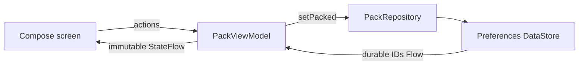

# Trail Pack

**A little preparation. More possibility.**

An original native Android showcase by [Ramy Saleeb](https://github.com/RamySaleeb): a small, offline packing checklist built with **Kotlin, Jetpack Compose, StateFlow, and Jetpack DataStore**.

The interface stays simple so the engineering decisions are easy to inspect: durable state, unidirectional data flow, lifecycle-aware collection, accessible controls, and explicit failure recovery. All content and application code were created for this public demo. No private or startup source is included.

## A two-minute walkthrough

1. Launch the app. Six fictional items are grouped by Essentials, Clothing, and Extras.
2. Tap **Water bottle**. The progress count advances only when storage emits the saved state.
3. Choose **Remaining** or **Packed** to inspect the same data through a different filter.
4. Close and reopen the app. Packed items survive; the presentation filter starts at All after process recreation.
5. Scroll to **Under the hood** and select **Simulate next save failure**. Tap an item: a recovery message appears, and saved selections stay unchanged. Tap the item again to save successfully.

There is no server to configure, no sign-in, and no `INTERNET` permission. The failure switch is an explicit teaching tool; normal saves use real device storage.

## Run locally

Requirements: Android Studio supporting AGP 9.1, JDK 17+, Android SDK 36, and an Android 8.0+ device or emulator (API 26+). Dependencies download from Google Maven, Maven Central, and the Gradle Plugin Portal.

```sh
git clone https://github.com/RamySaleeb/android-native-architecture-lab.git
cd android-native-architecture-lab
# Open this directory in Android Studio, let Gradle sync, then Run app.
# Or set ANDROID_HOME to your SDK directory and use:
sh gradlew :app:assembleDebug
sh gradlew :app:installDebug
```

This is a native Android application. It does not run as a browser app. The debug APK is produced at `app/build/outputs/apk/debug/app-debug.apk`; successful CI builds also retain an APK artifact for 14 days. Debug signing is for evaluation only.

## Architecture worth reading



| Boundary | Responsibility | Start here |
| --- | --- | --- |
| Compose | Render state; emit user actions; collect only with the lifecycle | [MainActivity.kt](app/src/main/java/com/ramysaleeb/trailpack/MainActivity.kt) |
| ViewModel | Read/save lifecycle, filters, single in-flight save, user-facing errors | [PackViewModel.kt](app/src/main/java/com/ramysaleeb/trailpack/PackViewModel.kt) |
| Repository | Observable packed IDs and atomic storage updates | [PackRepository.kt](app/src/main/java/com/ramysaleeb/trailpack/PackRepository.kt) |

### Deliberate tradeoffs

- **Storage is authoritative.** No optimistic checkmark means there is no rollback state to reconcile after a failed save.
- **Atomic updates.** DataStore serializes each read-modify-write transaction, avoiding lost updates. The UI also allows only one save at a time.
- **Read errors are visible.** A failed read does not silently become an empty checklist. Editing stays disabled until retry succeeds.
- **Cancellation stays cancellation.** Coroutine cancellation is rethrown rather than shown as a storage failure.
- **Small data, small architecture.** A preferences set is sufficient for six stable IDs. Room becomes appropriate if editable trips, relational queries, or migrations enter the scope. No DI framework or artificial module split is needed for this sample.
- **One process, one DataStore instance.** The application-context delegate owns storage. Dependency injection at the repository interface makes the ViewModel testable.
- **Durable versus transient state.** Packed IDs survive process recreation. The ViewModel retains filters across configuration changes; the filter and failure switch are intentionally not persisted across process death.

## Verification

```sh
sh gradlew :app:testDebugUnitTest :app:lintDebug :app:assembleDebug
# With an emulator/device connected:
sh gradlew :app:connectedDebugAndroidTest
```

Unit tests exercise loading and filters, pack/unpack, one-shot simulated failure, actual write failure, retry, pending-write exclusion, read recovery, and unknown IDs. Device tests exercise merged checkbox semantics, empty states, read recovery controls, and DataStore recreation with concurrent writes.

The layout uses wrapping filters, flexible item heights, a bounded reading width, safe-area padding, and whole-row checkbox targets. These are implementation choices, not a claim of complete accessibility conformance. TalkBack, hardware keyboard navigation, localization/RTL, and a wider device/font-scale matrix remain review areas.

## Contribute

See [CONTRIBUTING.md](CONTRIBUTING.md) for setup, checks, and focused ideas. Useful next steps include a larger accessibility test matrix, string-resource localization, and a design proposal for multiple independent trip lists.

## Scope

Fictional demonstration data; this is not an outdoor safety checklist. No analytics, cloud sync, accounts, location, payments, background jobs, or proprietary integrations. The current UI is English and uses a fixed light palette.

[MIT license](LICENSE) · [Flutter companion: Pocket Catalog](https://github.com/RamySaleeb/flutter-mobile-architecture-lab) · [More from Ramy](https://github.com/RamySaleeb)
